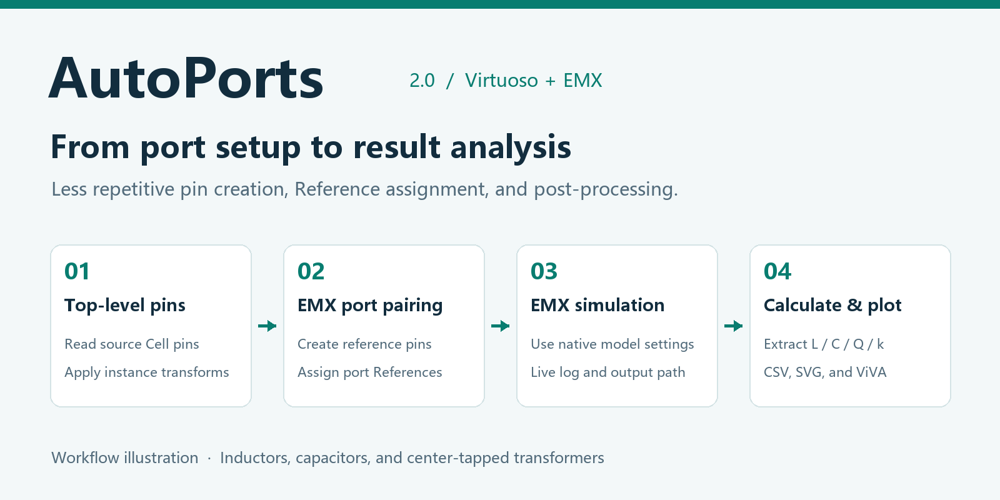
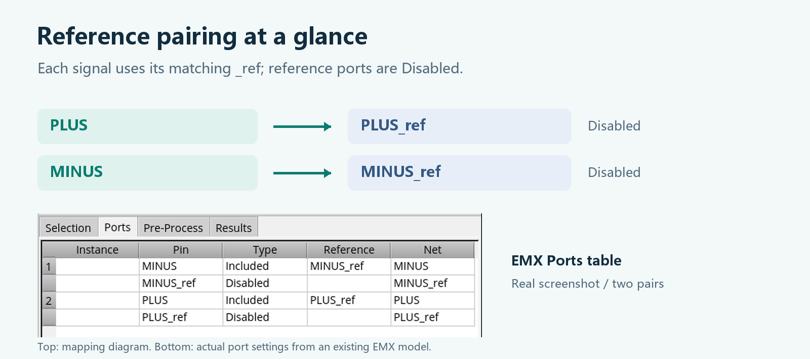
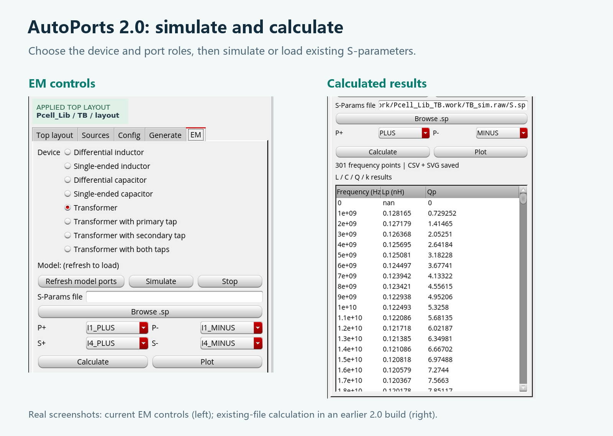
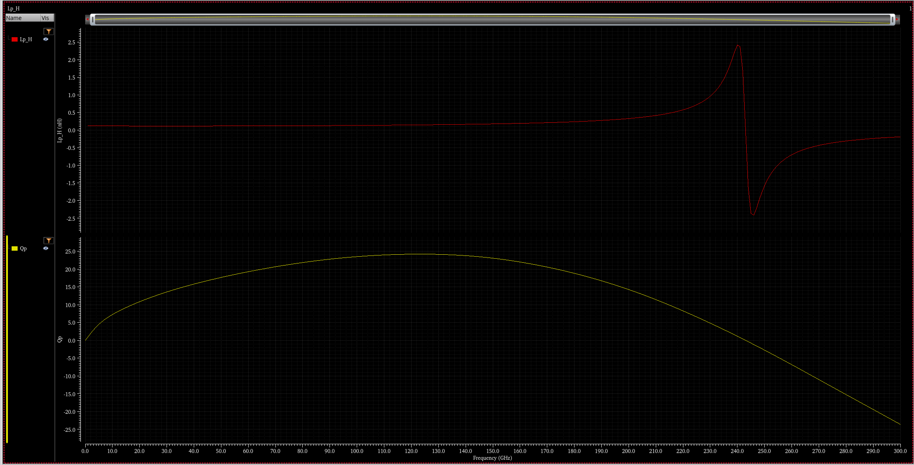

# AutoPorts: An Agent-Built Plugin for Layout EXL / EMX Port Setup, Simulation, and Plotting

[中文](introduction.zh-CN.md) | **English**



I built AutoPorts with an agent to take some of the repetition out of working with Cadence Virtuoso Layout EXL and EMX.

When simulating inductors, capacitors, or transformers, I kept repeating the same setup steps:

- Create top-level pins from the device instances.
- Create a reference pin for each signal pin.
- Generate EMX ports and assign their References. In my EXL workflow, regenerating the ports meant setting those references again, which quickly became tedious.
- Find the S-parameter file after the simulation finishes.

AutoPorts brings those steps, along with result calculation and plotting, into one Virtuoso plugin.

## What can AutoPorts do?

### 1. Generate top-level pins

AutoPorts reads existing pins from a source Cell or PCell and creates the corresponding pins in a selected top-level layout. It accounts for instance placement, rotation, and mirroring.

It also supports a configurable hierarchy depth for designs whose pins are inside nested instances.

### 2. Create reference pins

Choose a reference metal layer for each source Cell. AutoPorts creates matching `_ref` pins at the same positions and with the same shapes as the signal pins:

```text
PLUS      → PLUS_ref
MINUS     → MINUS_ref
```

This reduces manual drawing and naming work.

### 3. Generate EMX ports and pair References

For the current EMX model, AutoPorts can:

- Generate ports from the top-level pins.
- Assign each signal port its matching `_ref` Reference.
- Set reference ports to Disabled.
- Save the model settings.

If the ports were already generated with Cadence's native tools, AutoPorts can just pair the existing References.



*The diagram shows the mapping; the real Ports table below confirms it. PLUS references PLUS_ref, MINUS references MINUS_ref, and both reference ports are Disabled.*

### 4. Launch EMX simulations

AutoPorts 2.0 launches the selected model using its existing native EMX settings. A live log window shows progress, errors, output paths, elapsed time, and memory usage.

After a successful run, AutoPorts attempts to locate the S-parameter file generated by that run and fill in its path automatically. The Stop button supports local EMX jobs on the same Linux host as Virtuoso.



*Left: the EM page with Simulate, Stop, Calculate, and Plot. Right: an earlier 2.0 screenshot showing L and Q calculated from an existing S-parameter file.*

### 5. Calculate and plot passive-device parameters

AutoPorts 2.0 reads Touchstone files or Spectre ASCII PSF S-parameter results and calculates:

- Inductors: L and Q.
- Capacitors: C and Q.
- Transformers: Lp, Qp, Ls, Qs, and coupling coefficient k.
- Center-tapped transformers: full-winding and individual winding-section L and Q.

There are eight device modes: single-ended and differential inductors, single-ended and differential capacitors, a standard transformer, and transformers with primary, secondary, or both center taps.

Results are available as a table in the plugin, CSV / TSV exports, standalone SVG plots, and separate traces in ViVA.



*Real ViVA output: inductance above and Q below. These curves belong to an existing test model and illustrate the plotting feature.*

### 6. Save and restore settings

Save the target Library / Cell / View, enabled source Cells, reference layers, hierarchy depth, device mode, port-role mappings, and S-parameter path. Restore the configuration when returning to the project.

## A typical workflow

```text
Choose the top-level layout
    ↓
Choose source Cells and reference layers
    ↓
Generate signal and reference pins
    ↓
Generate EMX ports and pair References
    ↓
Run EMX with the existing native settings
    ↓
Automatically locate the S-parameter output
    ↓
Calculate and plot L / C / Q / k
```

## Who is it for?

AutoPorts is intended for designers who regularly use Virtuoso Layout EXL / EMX for passive-device simulations, rebuild top-level test layouts, or repeatedly configure ports for inductors, capacitors, and transformers.

It is especially useful when you want to spend less time on naming, Reference assignments, and result-file handling.

## Before using it

- Cadence, the PDK, EMX, and their licenses must already be available.
- AutoPorts uses the EMX model, process file, and simulation settings you have configured.
- **Generate pins clears all existing top-level pins in the selected layout**, then rebuilds them from enabled source instances. Try it on a test layout first.
- Reference-layer selection, return paths, extraction scope, and the final electromagnetic performance still require engineering review.
- The shell installer can run without Python. Result calculation, plot preprocessing, and some runtime controls require Python 3.8 or newer.

AutoPorts connects port preparation, simulation, and result analysis in one workflow, leaving more time for device design and interpreting the results.
